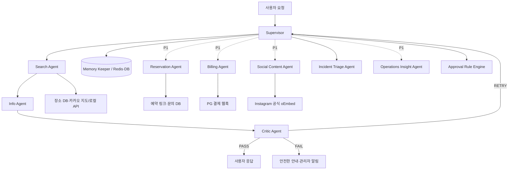

# MuinGuard 멀티 에이전트 아키텍처 설계서

## 1. 아키텍처 선택

**구조:** Supervisor 기반 중앙 조정형 + 공유 상태 저장소

**선정 이유:** P0의 검색·정보·시설 제보 기능을 역할별로 분리하고, Supervisor가 재시도·폴백·종료를 한 곳에서 일관되게 통제한다. 예약·결제 Agent는 P1 확장 시 추가한다. Critic 검증을 통과한 정보만 사용자에게 제공한다.

## 2. 전체 구조



## 3. 공유 상태

| 데이터 | 저장 위치 | 목적 |
| --- | --- | --- |
| task ID·현재 단계·시도 횟수 | Redis | 작업 복원·중복 방지 |
| 장소·회원·리뷰·구독 상태 | PostgreSQL | 영속 데이터 |
| 조직·지점·직원 권한·시설 제보 | PostgreSQL | 다점포 운영·처리 이력 |
| 검색·좌표 캐시 | Redis | 외부 지도 장애 폴백 |
| 원본 API 응답 참조 | DB/로그 저장소 | 근거·감사 추적 |
| 장애·복구 이력 | recovery_logs | 운영 지표·발표 증빙 |

## 4. 책임 분리 점검

- Supervisor는 도구를 직접 실행하지 않고 흐름만 제어한다.
- Search Agent는 후보 검색만 하며 운영시간을 추정하지 않는다.
- Info Agent는 원본을 정리하되 사실을 임의 생성하지 않는다.
- Critic은 PASS/RETRY/FAIL만 결정하고 응답을 수정하지 않는다.
- Memory Keeper는 API 키, 비밀번호, 카드정보를 저장하지 않는다.

## 5. 주요 장애 복구 흐름

### 지도 API 장애

```text
Search Agent 실패
→ Supervisor가 timeout/error 유형 기록
→ 최대 2회 재시도
→ Redis 캐시 좌표·장소 목록으로 폴백
→ Critic이 캐시 시각·필수 필드를 검증
→ 사용자에게 목록 제공 및 지도 제한 안내
```

### P1 구독 결제 이벤트 장애

```text
PG 웹훅 수신 또는 지연 감지
→ Billing Agent가 서명·event ID·payment ID 검증
→ 결제 상태 재조회
→ 1회 상태 갱신 또는 작업 큐 재처리
→ 실패 시 PAST_DUE 유예와 결제 갱신 안내
```

### P1 Instagram 임베드 장애

```text
공개 게시물/Reel URL 표시 요청
→ Social Content Agent가 공식 임베드 가능 여부 확인
→ 임베드 성공: 최근 소식 카드 표시
→ 비공개·삭제·임베드 제한: 콘텐츠 저장 없이 Instagram 프로필 링크로 폴백
→ 장소 탐색·상세의 핵심 흐름은 계속 제공
```

### 시설 장애 제보 흐름

```text
고객 제보 등록
→ Incident Triage Agent가 키오스크/결제/출입문/청결 등으로 분류
→ 유사 제보·심각도 확인
→ 해당 지점 담당자 알림
→ 운영자가 ASSIGNED/IN_PROGRESS/RESOLVED로 상태 변경
→ Operations Insight Agent가 반복 장애를 주간 리포트에 반영
```

### 사장 등록·자동 승인 흐름

```text
사장 장소 등록
→ Approval Rule Engine이 사업자 인증·필수 필드·중복 후보·정책 신호 검사
→ 전체 통과: AUTO_APPROVED 및 공개
→ 하나라도 미충족: PENDING_REVIEW와 누락 사유 생성
→ 관리자가 예외 건만 승인/반려
→ 모든 판단과 변경 이력을 감사 로그에 저장
```

## 6. 보안 설계

- 서비스 키는 환경 변수/Secret Manager에서만 조회한다.
- 웹훅 서명 검증과 event ID 멱등성 처리를 적용한다.
- 역할 기반 접근 제어(RBAC)로 운영자·관리자 기능을 제한한다.
- 프롬프트에 시크릿 공개·권한 상승·데이터 변경 요구가 있으면 차단·기록한다.

## 7. 관측성 및 품질 게이트

모든 작업 로그에는 `task_id`, `agent`, `attempt`, `started_at`, `finished_at`, `outcome`, `fallback_used`를 기록한다. 운영 대시보드에서는 다음을 표시한다.

- API 성공률·P95 응답 시간
- Agent별 PASS/RETRY/FAIL과 평균 실행 시간
- P0 장애 유형별 자동 복구율·평균 복구 시간
- 미처리 시설 장애 제보와 심각도 높은 제보 수

배포 전에는 단위 테스트, 통합 테스트, 조직 데이터 격리 테스트, P0 장애 폴백 테스트를 모두 통과해야 한다.

