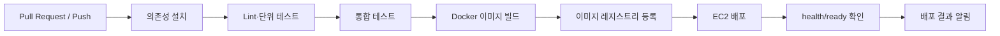

# MuinGuard 파이프라인 구현 결과 보고서

> 구현 전에는 정책과 템플릿으로 사용하고, 구현 뒤에는 실제 실행 ID·커밋·결과·로그 링크로 교체한다.

## 1. 파이프라인 목적

코드 변경이 운영 환경으로 배포되기 전에 빌드, 테스트, 보안 점검, 이미지 생성, 배포 후 상태 확인을 통과하도록 한다. 테스트가 실패하면 배포를 차단한다.

## 2. 전체 흐름

## 3. 단계별 정책

| 단계 | 입력 | 성공 조건 | 실패 처리 |
| --- | --- | --- | --- |
| Lint | 소스코드 | 정적 검사 통과 | 파이프라인 중단 |
| 단위 테스트 | 모듈·Mock | 핵심 서비스 테스트 통과 | 배포 차단·로그 저장 |
| 통합 테스트 | API·DB·Redis·Agent | 검색/로그인/복구 시나리오 통과 | 배포 차단 |
| 이미지 빌드 | Dockerfile | 이미지 빌드 성공 | 레지스트리 미등록 |
| 배포 | 검증 이미지 | 컨테이너 실행 | 이전 버전 유지/롤백 |
| 상태 확인 | `/health`, `/ready` | 설정한 시간 내 정상 | 롤백·알림 |

## 4. 필수 테스트 목록

- 회원가입·로그인·권한 차단
- 현재 위치/좌표 기반 장소 검색
- 장소 상세·즐겨찾기·리뷰
- 예약 문의 생성 (P1)
- Pro 구독 권한과 결제 실패 유예 (P1)
- 시설 장애 제보 생성·분류·담당자 상태 변경
- 사업자 조직의 다점포 권한 및 지점별 데이터 격리
- 장소 정보 출처·검증 상태 API 응답
- 사장 등록의 자동 승인·관리자 검토 전환·감사 로그
- 장애 폴백 시 사용자 안전 안내와 recovery log 생성
- 지도 API 타임아웃 시 캐시 폴백
- DB 연결 오류 시 재연결 또는 읽기 캐시
- 결제 웹훅 중복 수신 시 한 번만 상태 갱신 (P1)
- 공개 Instagram 임베드 오류 시 프로필 링크 폴백 (P1)
- Handoff의 task ID·attempt·memory reference 누락 검사

## 5. GitHub Actions 구현 체크리스트

- [ ] PR에서 lint와 테스트를 실행한다.
- [ ] main 브랜치에서만 배포 작업을 실행한다.
- [ ] API 키·DB 비밀번호는 GitHub Secrets로 주입한다.
- [ ] 테스트 실패 시 이미지 배포 단계를 실행하지 않는다.
- [ ] 배포 후 readiness 실패 시 이전 정상 버전을 유지하거나 롤백한다.
- [ ] 성공/실패/지연을 지정 채널에 알린다.
- [ ] 운영용 장애 주입 API는 비활성화하고 테스트 환경에서만 허용한다.

## 6. 실제 실행 결과

| 항목 | 실제 값 |
| --- | --- |
| Pipeline ID | `[작성]` |
| Commit hash | `[작성]` |
| 시작/종료 시각 | `[작성]` |
| 단위 테스트 | `[통과 수/전체 수]` |
| 통합 테스트 | `[통과 수/전체 수]` |
| 이미지 태그 | `[작성]` |
| 배포 결과 | `[성공/실패/롤백]` |
| 총 실행 시간 | `[작성]` |
| 로그 URL | `[작성]` |

## 7. 실패 사례·개선 이력

| 날짜 | 실패 단계 | 원인 | 조치 | 재발 방지 |
| --- | --- | --- | --- | --- |
| `[작성]` | `[작성]` | `[작성]` | `[작성]` | `[작성]` |

