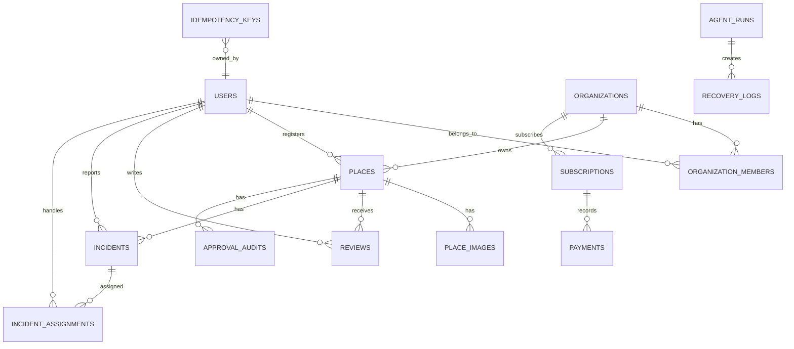

# MuinGuard 데이터·API 계약 설계서

## 1. 핵심 ERD



## 2. 엔터티와 제약조건

| 엔터티 | 핵심 필드 | 필수 제약 |
| --- | --- | --- |
| users | id, email, password_hash, role, status | email unique, 비밀번호 해시만 저장 |
| organizations | id, owner_id, name, status | owner는 활성 사용자 |
| organization_members | organization_id, user_id, role | 조직·사용자 unique, role enum |
| places | id, organization_id, registered_by, status, name, address, lat, lng | 조직 소유, 승인 상태 enum |
| place_images | place_id, url, is_primary | 장소당 대표 이미지 최대 1개 |
| incidents | id, place_id, reporter_id, category, severity, status | 상태·심각도 enum, 생성 후 감사 로그 |
| incident_assignments | incident_id, assignee_id, assigned_at, resolved_at | 담당자는 해당 조직 멤버 |
| approval_audits | place_id, actor_id, decision, rule_version, reason | append-only |
| idempotency_keys | key, actor_id, endpoint, request_hash, response_ref, expires_at | actor+endpoint+key unique |
| agent_runs | task_id, agent, attempt, outcome, started_at | task+agent+attempt unique |

### 조직 격리 규칙

- 장소·제보·통계 조회는 `organization_id`를 토큰의 조직 멤버십과 서버에서 대조한다.
- 클라이언트가 전달한 `organization_id`는 권한 판단 근거가 아니다.
- 감사 로그에는 민감 원문 대신 식별자·행위·시각·결과를 기록한다.

## 3. 상태 머신

### 장소 승인

```text
DRAFT → PENDING_REVIEW → APPROVED → SUSPENDED
  └→ AUTO_APPROVED ────────────┘
PENDING_REVIEW → REJECTED → DRAFT
```

### 시설 제보

```text
RECEIVED → ASSIGNED → IN_PROGRESS → RESOLVED → CLOSED
RECEIVED/ASSIGNED → DUPLICATE
RECEIVED → REJECTED
```

상태 변경은 유효한 전이만 허용하며, 모든 변경은 `incident_history` 또는 감사 로그에 남긴다.

## 4. API 계약 공통

### 목록 조회

```http
GET /api/v1/places?latitude=37.4981&longitude=127.0276&radius=3000&cursor=...
```

```json
{
  "success": true,
  "data": { "items": [], "nextCursor": null },
  "error": null,
  "requestId": "req_..."
}
```

### 오류 형식

```json
{
  "success": false,
  "data": null,
  "error": {
    "code": "APPROVAL_RULE_MISSING_FIELD",
    "message": "대표 사진이 필요합니다.",
    "details": { "field": "primaryImage" }
  },
  "requestId": "req_..."
}
```

| HTTP | 대표 코드 | 의미 |
| --- | --- | --- |
| 400 | VALIDATION_ERROR | 입력 형식 오류 |
| 401 | UNAUTHENTICATED | 로그인 필요 |
| 403 | FORBIDDEN_ORGANIZATION | 조직 권한 없음 |
| 404 | NOT_FOUND | 리소스 없음 |
| 409 | IDEMPOTENCY_KEY_CONFLICT | 같은 키에 다른 요청 본문 |
| 422 | APPROVAL_RULE_MISSING_FIELD | 자동 승인 조건 미충족 |
| 429 | RATE_LIMITED | 요청 제한 |
| 503 | DEPENDENCY_UNAVAILABLE | 외부 의존성 장애·폴백 안내 |

## 5. 핵심 요청 예시

### 사장 장소 등록

```http
POST /api/v1/places
Authorization: Bearer {token}
Idempotency-Key: 6d9d...
```

```json
{
  "organizationId": "org_01",
  "name": "Muin Stay 강남점",
  "category": "UNMANNED_HOTEL",
  "address": "서울시 강남구 ...",
  "latitude": 37.4981,
  "longitude": 127.0276,
  "phone": "02-0000-0000",
  "businessHours": "24시간",
  "checkInGuide": "키오스크 비대면 체크인",
  "instagramProfileUrl": "https://www.instagram.com/example"
}
```

성공 응답은 `AUTO_APPROVED` 또는 `PENDING_REVIEW`와 `missingRequirements`를 반환한다. 자동 승인 규칙 오류는 장소를 공개하지 않는다.

### 시설 제보 생성

```json
{
  "category": "KIOSK",
  "severity": "HIGH",
  "description": "결제 단계에서 멈춥니다.",
  "photoUrl": "upload reference"
}
```

서버는 중복 요청에 기존 incident ID를 반환하고, 심각도 HIGH 이상이면 알림 작업을 생성한다.

## 6. 보존·파기 정책 초안

| 데이터 | 목적 | 초안 보존 기준 | 파기/비식별 원칙 |
| --- | --- | --- | --- |
| 계정 정보 | 인증·서비스 운영 | 탈퇴/법정 보관 기준 검토 | 탈퇴 후 지연 파기 정책 적용 |
| 제보 사진·내용 | 시설 문제 처리 | 처리 완료 후 운영 정책 기간 | 접근 제한, 만료 후 파기 |
| 승인 증빙 | 등록 신뢰·감사 | 분쟁/운영 필요 기간 | 최소 항목만 분리 보관 |
| 분석 이벤트 | 제품 개선 | 집계·비식별 기준 | 원문 개인정보 미포함 |
| 결제 이벤트(P1) | 결제 상태·감사 | PG·법정 기준 확인 | 카드정보 미저장 |

보존 기간은 실제 출시 전 법령·계약·정책 검토를 거쳐 확정하고 개인정보 처리방침과 일치시킨다.

